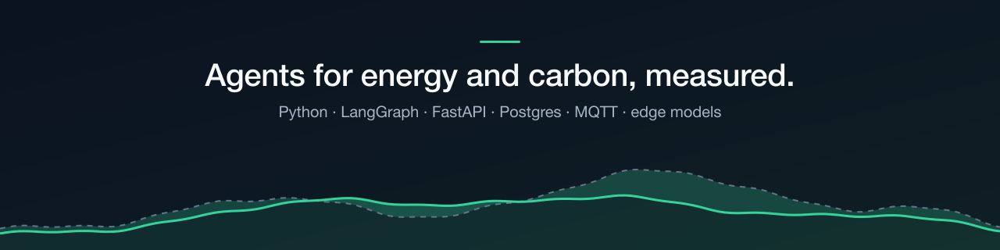

### Hi, I'm Sathees 👋

I'm an applied AI engineer for **energy and carbon operations**, and I came to it through software
engineering. I build **multi-agent systems**, plus the evals, tracing and cost work that makes them
production-ready. My MSc dissertation, AgentC, cut Scope 2 emissions by 14.7% with zero constraint
violations in a 19-day physical trial.

I'm building in public. Each project I share aims to be end-to-end: deployed, tested, traced.

**🛠 Stack:** Python · FastAPI · LangGraph · PostgreSQL/pgvector · MQTT · Node-RED · TypeScript · Next.js

**🔋 Learning now:** time-series forecasting · edge LLMs (llama.cpp, Ollama, ONNX Runtime) · OPC UA · Modbus

**📈 What I'm doing now**
- 🔋 Starting AgentC Edge: small models on a box inside the site, advising on real meter data, with human approval
- 🔭 Building [partquote](https://github.com/PaSathees/partquote), agentic quoting on real jobs from my 3D-printing business (FastAPI · LangGraph)
- 🤖 Built AgentC (Jul 2025 to Jul 2026): a hierarchical multi-agent LangGraph system with IoT, my MSc dissertation. Source stays private until convocation.
- ✍️ Writing short posts on what I get wrong along the way

**🌐** [satheespaskaran.com](https://satheespaskaran.com)

_It's a journey log, not a tutorial. If something here helps you, take it._
